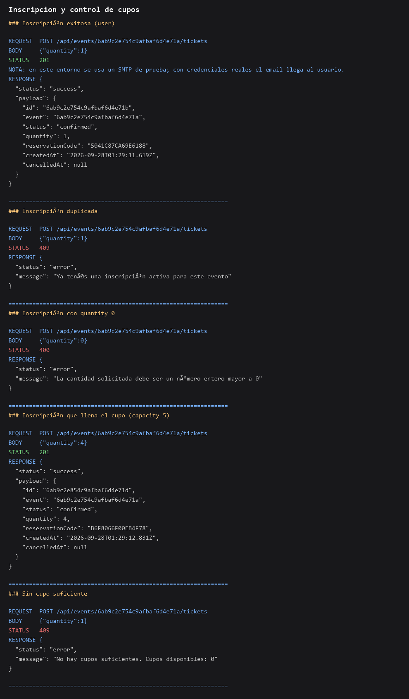
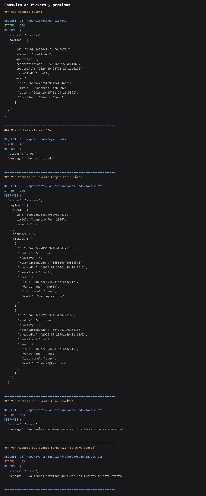
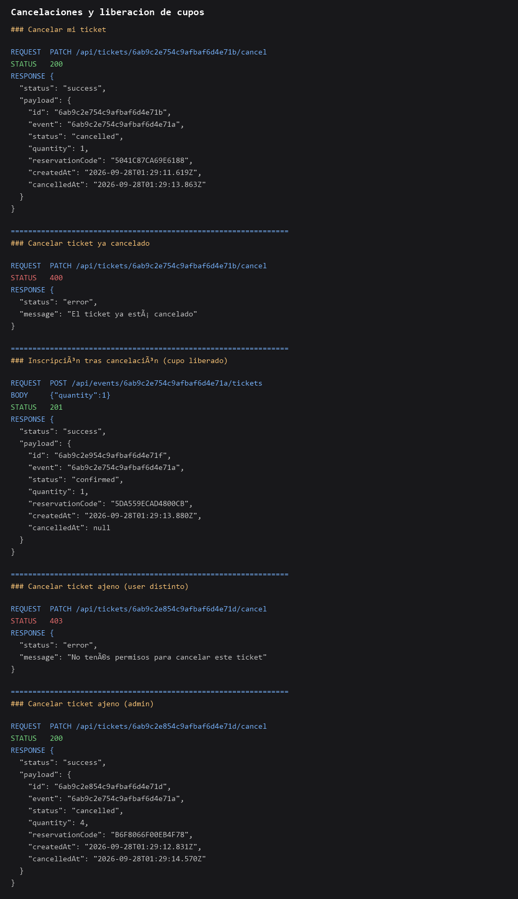

# Backend de Eventos - Tickets, inscripciones y control de cupos

API construida con **Node.js, Express, MongoDB y Mongoose** para la **Plataforma
de Eventos e Inscripciones**: entidad **Ticket**, flujo de **inscripción** con
**control de cupos**, **cancelaciones** y **notificaciones por email** con
Nodemailer.

Pre-entrega 8 — Arquitectura en capas: **DAO, Repository y DTO**.

Continúa el proyecto de la pre-entrega 7 (tickets, inscripciones, cupos y
notificaciones) sobre la base de la pre-entrega 6 (autenticación JWT + cookies
HTTP Only, roles `user`/`organizer`/`admin` y entidad **Event**). En esta
entrega se formalizó la separación de responsabilidades:
**DAO** encapsula el acceso a Mongoose, **Repositories** actúan como capa
intermedia orientada al dominio, **Services** concentran la lógica de negocio
y **DTO** controlan todas las respuestas de la API.

## Modelo Ticket

| Campo | Tipo | Reglas |
|-------|------|--------|
| `user` | ObjectId (ref `User`) | **Referencia**, requerida, indexada |
| `event` | ObjectId (ref `Event`) | **Referencia**, requerida, indexada |
| `status` | String | Solo `confirmed`, `pending`, `cancelled` |
| `quantity` | Number | `quantity > 0` |
| `reservationCode` | String | Único, se genera al crear |
| `createdAt` | Date | Auto (default `Date.now`) |
| `cancelledAt` | Date | `null` hasta la cancelación |

> No se embeben objetos completos: `user` y `event` guardan solo su `ObjectId`.
> Index compuesto `{ user, event }` para detectar inscripciones duplicadas.

## Endpoints

| Método | Ruta | Acceso | Descripción |
|--------|------|--------|-------------|
| POST | /api/events/:eid/tickets | **autenticado** | Inscribe en el evento y crea el ticket |
| GET | /api/tickets/my-tickets | **autenticado** | Tickets del usuario (con evento `title`, `date`, `location`) |
| GET | /api/events/:eid/tickets | organizer **del evento** o admin | Tickets de ese evento con datos del usuario |
| PATCH | /api/tickets/:tid/cancel | dueño del ticket o admin | Cancela el ticket (marca `cancelled` + `cancelledAt`) |

## Estados de ticket

| Estado | Significado |
|--------|-------------|
| `pending` | Reserva en proceso |
| `confirmed` | Inscripción confirmada (envía email) |
| `cancelled` | Cancelada; **no ocupa cupo** |

> **Cancelar no elimina el documento**: se cambia a `cancelled` y se registra
> `cancelledAt`. No hay borrado físico.

## Flujo de inscripción (validado en `src/services/tickets.service.js`)

Al hacer `POST /api/events/:eid/tickets` se valida en este orden:

1. El evento **existe** (→ **404**).
2. El evento está **`published`** — `draft`, `cancelled` y `finished` no
   permiten inscribirse (→ **400**).
3. La **fecha del evento no ha pasado** todavía (→ **400**).
4. `quantity` es un número entero **> 0** (→ **400**).
5. **Cupos disponibles ≥ quantity**: se suma la `quantity` de los tickets
   activos (`confirmed`/`pending`) del evento.
   `disponible = capacity - ocupados`. Si no alcanza → **409**.
6. El usuario **no tiene ya un ticket activo** para ese evento (→ **409**).
   Los tickets `cancelled` no bloquean nuevas inscripciones.
7. Se crea el ticket **`confirmed`** con `reservationCode` aleatorio y se envía
   la **notificación por email**.

## Cancelación

`PATCH /api/tickets/:tid/cancel`:

- El ticket debe **existir** (→ **404**).
- Debe pertenecer al solicitante **o** ser `admin` (→ **403** si no).
- Si ya está cancelado → **400**.
- Cambia `status` a `cancelled` y setea `cancelledAt`; **el cupo queda
  disponible automáticamente** porque los `cancelled` no se cuentan.

## Notificaciones (Nodemailer)

- Al confirmar una inscripción se envía un email con evento, cantidad y
  `reservationCode`.
- Al **cancelar** una inscripción se envía un email de cancelación al dueño
  real del ticket (aunque la cancele un admin), con evento y `reservationCode`.
- Las credenciales se leen **siempre de variables de entorno**:
  `MAIL_HOST`, `MAIL_PORT`, `MAIL_USER`, `MAIL_PASS`, `MAIL_FROM`
  (definidas en `.env.example`). Nunca hardcodeadas.
- Si el email falla, la operación no se pierde: se loguea el error y se
  responde igual (la inscripción/cancelación ya quedó registrada).

## Códigos de error

| Código | Cuándo |
|--------|--------|
| 200 / 201 | Éxito |
| 400 | Datos inválidos o regla de negocio (evento no publicado, evento con fecha ya pasada, quantity ≤ 0, ya cancelado) |
| 401 | Sin sesión válida |
| 403 | Sesión pero sin permiso (rol o propiedad del recurso) |
| 404 | Evento o ticket inexistente / mal formado |
| 409 | Cupo insuficiente o inscripción duplicada |
| 500 | Error interno (solo fallos no anticipados) |

## Arquitectura

API organizada en capas formales. El flujo de una petición es:

`routes → controllers → services → repositories → DAO → models (Mongoose)`

| Capa | Responsabilidad | Regla |
|------|-----------------|-------|
| `routes/` | Método, ruta y middlewares (auth 401, autorización por rol 403) | Sin lógica de negocio |
| `controllers/` | Coordinan request/response: leen `body`/`params`/`query`, llaman al service y responden JSON | **No importan modelos** ni resuelven reglas |
| `services/` | **Toda la lógica de negocio**: cupos, estados, duplicados, permisos sobre recursos propios, email | Consumen **repositories**, nunca DAO/modelos |
| `repositories/` | Capa intermedia orientada al dominio: `findByEmail`, `findActiveByUserAndEvent`, `countActiveTickets`, `cancelTicket`, `findByEvent`, `findByUser`… | Usan el **DAO** correspondiente |
| `dao/` | Acceso a datos: `findById`, `findOne`, `create`, `update`, `count`… | **Únicos** que importan modelos de Mongoose |
| `dto/` | Serializan respuestas y filtran datos sensibles (incluye el resultado de los `populate`) | Ninguna respuesta expone `password` |
| `models/` | Esquemas de Mongoose: `User.js`, `Event.js`, `Ticket.js` | - |

### DTOs

| DTO | Respuestas que serializa |
|-----|--------------------------|
| `user.dto.js` | `userDTO` → `register`, `/current`, listado admin; `userSummaryDTO` → usuario embebido en tickets |
| `event.dto.js` | `eventDTO` → evento público (organizer filtrado si viene populado); `eventTicketListDTO` → resumen en "tickets por evento" |
| `ticket.dto.js` | `ticketDTO` → crear/cancelar; `myTicketsDTO` → mis tickets (evento populado); `eventTicketsDTO` → tickets de un evento (usuario populado) |

> Ninguna respuesta expone `password` ni su hash. Cuando hay `populate`,
> el DTO filtra también los campos del documento relacionado.

### Estructura

```
src/
  app.js                    # Express + routers + middleware central de errores
  config/                   # env (fail-fast), database, passport
  models/                   # User.js, Event.js, Ticket.js
  dto/                      # user, event, ticket (serialización de respuestas)
  controllers/              # solo request/response
  services/                 # lógica de negocio: tickets (cupos), events, sessions, users, mail
  repositories/             # capa intermedia orientada al dominio
  dao/                      # único lugar que importa modelos Mongoose
  middlewares/              # auth (401), authorize (403), errorHandler
  routes/                   # sessions, events, tickets, users
  utils/                    # jwt, hash, errors (HttpError)
```

## Instalación y variables de entorno

```bash
npm install
Copy-Item .env.example .env   # PowerShell (o cp .env.example .env)
npm run dev
```

Variables del `.env`:

| Variable | Descripción | Obligatoria |
|----------|-------------|-------------|
| `PORT` | Puerto del servidor | No (default `3000`) |
| `MONGO_URL` | Cadena de conexión a MongoDB | **Sí** |
| `JWT_SECRET` | Clave para firmar el JWT | **Sí** |
| `JWT_EXPIRES_IN` | Expiración del JWT | No (default `1h`) |
| `NODE_ENV` | `development` / `production` | No |
| `MAIL_HOST` | Host SMTP (ej: `smtp.gmail.com`, Mailtrap) | **Sí** |
| `MAIL_PORT` | Puerto SMTP (465 SSL / 587 STARTTLS) | No (default `587`) |
| `MAIL_USER` | Usuario SMTP | **Sí** |
| `MAIL_PASS` | Password / App Password SMTP | **Sí** |
| `MAIL_FROM` | Remitente de los correos | **Sí** |

> **No se sube `.env`, `node_modules` ni credenciales** al repositorio
> (`.gitignore` los excluye).

## Tests automatizados

La suite end-to-end vive en `tests/api.test.js` y usa el **runner nativo de
Node** (`node --test`), **supertest** como cliente HTTP y
**mongodb-memory-server** para levantar una base MongoDB real en memoria (no
requiere una instancia local de MongoDB).

```bash
npm test
```

Cubre **39 casos** (sesiones, eventos, inscripciones/cupos, cancelaciones y
autorización administrativa), incluidas las verificaciones de que ninguna
respuesta expone `password`. Resultado actual: **39/39 PASS**.

Detalle completo en [`docs/reporte-ejecucion-tests.md`](docs/reporte-ejecucion-tests.md)
y en [`docs/informe-revision-deterministica.md`](docs/informe-revision-deterministica.md).

## Casos de prueba verificados

1. Inscripción exitosa → **201** + intento de email
2. Inscripción sin sesión → **401**
3. Inscripción a evento inexistente → **404**
4. Inscripción a evento cancelado/finalizado → **400**
5. Inscripción a evento publicado **con fecha ya pasada** → **400**
6. Sin cupo suficiente → **409** con mensaje claro de cupos disponibles
7. Inscripción duplicada activa → **409**
8. Cancelación propia → **200** (status `cancelled`); cupo se libera → nueva
   inscripción funciona
9. Cancelación ya cancelado → **400**
10. Cancelación de ticket ajeno como user → **403**; como admin → **200**
11. `GET /api/events/:eid/tickets` como user común → **403**
12. `GET /api/events/:eid/tickets` como organizer de otro evento → **403**
13. `GET /api/tickets/my-tickets` sin sesión → **401**

## Evidencias





